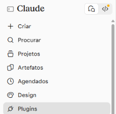
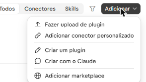
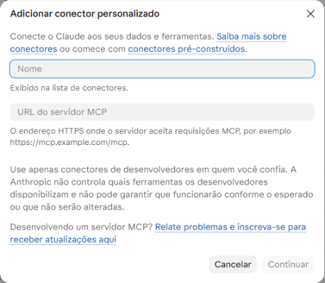

# Instrução de Trabalho: Conectar o Claude ou o ChatGPT ao IBN

| | |
|---|---|
| **Objetivo** | Deixar o seu Claude ou o seu ChatGPT consultando o sistema IBN (clientes, vendas, parcelas, turmas e treinandos) pela conversa. |
| **Quem Faz** | Cada pessoa liberada, na própria conta. Leva cerca de 5 minutos. |
| **Onde** | No computador, pelo navegador. Depois de pronto, também funciona no celular. |
| **Versão** | 18/11/2026 |

## Antes de Começar: Tenha em Mãos

**A. Confirme que você foi liberado no conector.**
Quem libera é o Zamir. Sem a liberação, a conexão para na tela do IBN com o aviso "Seu usuário ainda não foi liberado".

**B. Saiba o seu e-mail e senha do sistema IBN.**
É o mesmo login que você usa em sistema.ibncoaching.com.br.

**C. Tenha um plano pago do assistente.**
Claude: Pro, Max, Team ou Enterprise. ChatGPT: Plus, Pro, Business ou Enterprise.

**D. Desligue o treino com as suas conversas.**
- Claude: Configurações, Privacidade, desligue "Ajudar a melhorar o Claude".
- ChatGPT: Configurações, Controles de Dados, desligue "Melhorar o modelo para todos".
- Nos planos de empresa isso já vem desligado.

> **Copie daqui na hora de preencher**
>
> - Nome: `IBN`
> - Endereço: `https://sistema.ibncoaching.com.br/mcp`
> - ID do cliente no Claude: `ibn-claude`
> - ID do cliente no ChatGPT: `ibn-chatgpt`
> - Segredo do cliente: deixe sempre em branco

## Parte 1: Conectar o Claude

**Passo 1.** Abra `claude.ai` no navegador do computador e entre na sua conta.

**Passo 2.** No menu da esquerda, clique em **Plugins**.

Você vai ver a página **Seus plugins**.

**Passo 3.** No canto de cima, à direita, clique em **Adicionar** e depois em **Adicionar conector personalizado**.

**Passo 4.** Preencha os dois campos e clique em **Continuar**:
- Nome: `IBN`
- URL do servidor MCP: `https://sistema.ibncoaching.com.br/mcp`

Aparece "Verificando o servidor" e depois a tela de autenticação.

**Passo 5.** Na tela de autenticação, marque a opção **Use seu próprio cliente OAuth**.
Não use "Usar a identidade publicada do Claude" nem "Registrar automaticamente": o IBN não aceita essas duas.

**Passo 6.** No campo **ID do cliente OAuth**, digite `ibn-claude`. Deixe o segredo em branco.

**Passo 7.** Clique em **Adicionar**.
O IBN aparece na lista Seus plugins como **Conector personalizado**.

**Passo 8.** Clique em **Conectar** no IBN.
Abre a tela de login do sistema IBN.

**Passo 9.** Entre com o seu e-mail e senha do IBN.
Se você já estiver logado no IBN nesse navegador, ele pula direto para o termo.

**Passo 10.** Leia o termo de uso, marque a caixa de aceite e clique em **Autorizar**.
Você volta para o Claude. **Pronto: o Claude está conectado ao IBN.**

**Passo 11.** Faça o teste: abra uma **conversa nova** e pergunte "Como estou na minha meta do mês?".
O Claude mostra que está consultando o IBN e responde com a sua meta. Se ele não usar o IBN, clique no botão de mais (+) da caixa de mensagem, vá em Conectores e confira se o IBN está ligado.

> **No celular:** abra o app do Claude com a mesma conta. O IBN já aparece, sem precisar refazer nada.

## Parte 2: Conectar o ChatGPT

> A OpenAI muda o nome dos menus com frequência. Se algum nome abaixo estiver diferente na sua tela, procure o mais parecido.

**Passo 1.** Abra `chatgpt.com` no navegador do computador e entre na sua conta.

**Passo 2.** Clique no seu nome, embaixo à esquerda, e abra **Configurações**.

**Passo 3.** Vá em **Aplicativos** (ou Aplicativos e Conectores) e abra **Configurações avançadas**.

**Passo 4.** Ligue o **Modo desenvolvedor**.
Se não achar ali, procure em Configurações, Segurança. Nos planos de empresa, o administrador da conta pode precisar liberar essa opção.

**Passo 5.** Volte em Aplicativos e clique em **Criar** (ou Adicionar servidor MCP).

**Passo 6.** Preencha:
- Nome: `IBN`
- URL do servidor MCP: `https://sistema.ibncoaching.com.br/mcp`
- Autenticação: **OAuth**

**Passo 7.** No método de registro, escolha **Cliente OAuth definido pelo usuário** e digite o ID do cliente `ibn-chatgpt`. Deixe o segredo em branco.

**Passo 8.** Marque que você confia no aplicativo e clique em **Criar**.

**Passo 9.** Clique em **Conectar**, entre com o seu e-mail e senha do IBN, marque o termo e clique em **Autorizar**.
Você volta para o ChatGPT. **Pronto: o ChatGPT está conectado ao IBN.**

**Passo 10.** Faça o teste: abra uma **conversa nova**, clique no botão de mais (+) da caixa de mensagem, escolha o **IBN** e pergunte "Como estou na minha meta do mês?".
No ChatGPT, o IBN precisa ser escolhido no botão de mais em cada conversa nova.

## Regras de Uso

- **Sempre comece uma conversa nova** para consultar o IBN. Uma conversa antiga pode não enxergar as consultas mais novas.
- O conector **só consulta**. Ele não cria, altera nem apaga nada no sistema.
- CPF, CNPJ, endereço e dados de cartão **nunca** saem. Telefone e e-mail saem mascarados.
- Você vê o que o seu acesso permite: a sua carteira e as suas vendas, ou tudo, se o Zamir liberou "vê tudo" para você.
- Limite: 30 consultas por minuto e 300 por dia, por pessoa. Toda consulta fica registrada no IBN.

## Se Der Errado

| O Que Aparece | O Que Fazer |
|---|---|
| "Seu usuário ainda não foi liberado para usar o conector" | Peça a liberação ao Zamir. |
| "O conector do IBN está desligado no momento" | Aguarde o aviso de que foi religado. |
| "Seu perfil no IBN não tem acesso a esta consulta" | O seu perfil no sistema não tem essa permissão. Fale com o Zamir. |
| Erro na tela de login logo depois do passo de autenticação | Confira o ID do cliente: `ibn-claude` no Claude e `ibn-chatgpt` no ChatGPT, com o segredo em branco. |
| "Já existe um conector com esta URL na sua organização" (Claude) | O IBN já foi adicionado na sua conta. Vá em Plugins, ache o IBN e clique em Conectar. |
| O assistente diz que teria que varrer meses de vendas para responder | Abra uma conversa nova e pergunte de novo. |
| O IBN parou de responder depois de alguns dias | Em Plugins (Claude) ou Aplicativos (ChatGPT), clique em Conectar no IBN e entre de novo com o seu login. |

## Para Desconectar

Em Plugins (Claude) ou Aplicativos (ChatGPT), abra o menu do IBN e escolha **Remover** ou **Desconectar**.
O acesso que ficou com o assistente perde a validade sozinho em até 1 hora. O Zamir também pode cortar o seu acesso pelo sistema, com efeito na hora.
